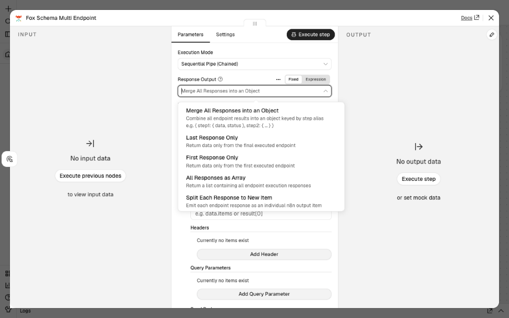
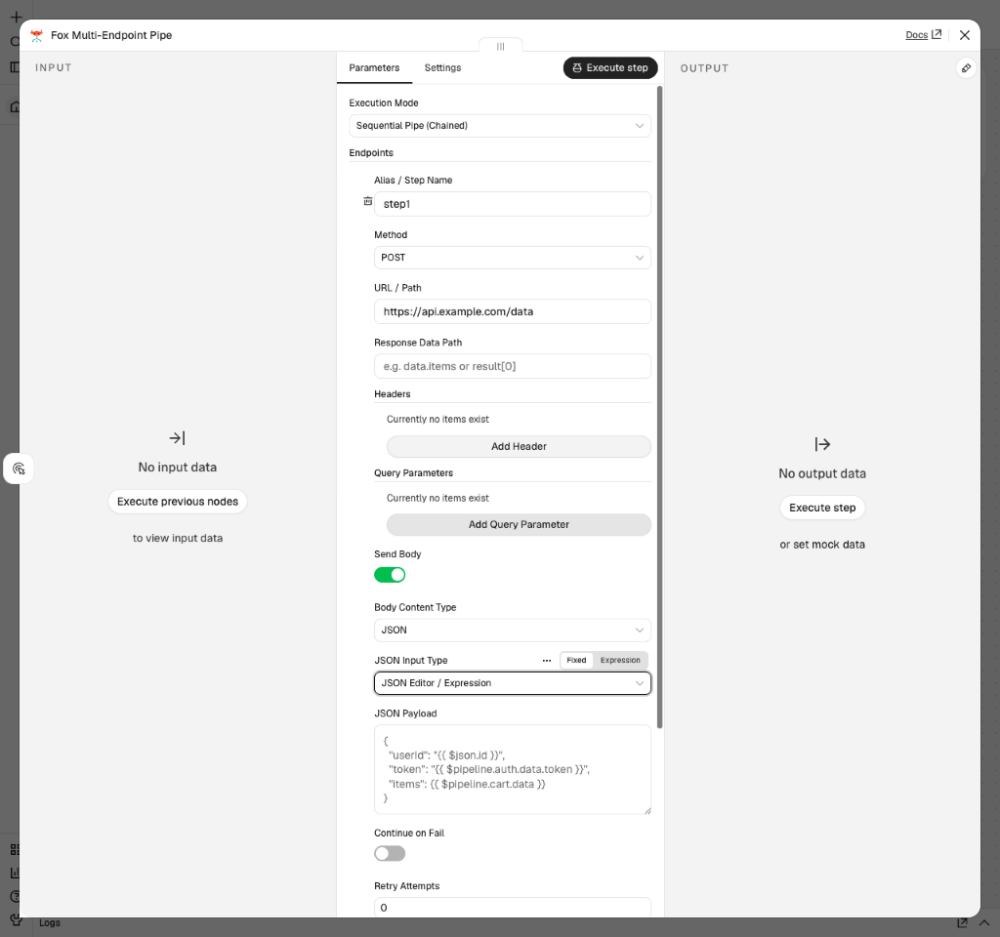

# Fox Schema Multi Endpoint Node for n8n

Custom community node for n8n designed to dispatch and orchestrate multiple HTTP requests in a single execution step.

Authored by **Huy Phan** ([@tedious-code](https://github.com/tedious-code) / <huyplb@live.com>).

## Highlights

- **Multi-Request Execution**: Define a sequence of API endpoints (chained pipeline) or run them concurrently in parallel.
- **Dynamic Context Passing**: Downstream endpoints can read data from earlier steps (`{{ $pipeline.step1.data }}`), immediate predecessor (`{{ $prev.data }}`), or the input item (`{{ $json.field }}`).
- **Configurable Response Output**:
  - `Merge All Responses into an Object`: Combined object keyed by step alias.
  - `Last Response Only`: Data from the final executed step.
  - `First Response Only`: Data from the first executed step.
  - `All Responses as Array`: Array of all responses.
  - `Split Each Response to New Item`: Individual n8n items.
  - `Merge into Input Item`: Enriches incoming `$json`.
- **Configurable Timeout**: Top-level default of `500ms`, editable globally or overridden per endpoint.
- **Request Body Options**: Supports JSON editor with expressions, visual field builder, form-urlencoded data, and raw text.
- **Direct Auth**: No credentials required; configure authorization headers directly.

## Visual Walkthrough

### Properties Panel & Timeout

### Response Output Selection

### Body Configuration

## Package

- Package Name: `n8n-nodes-fox-schema-multi-enpoints`
- License: MIT
